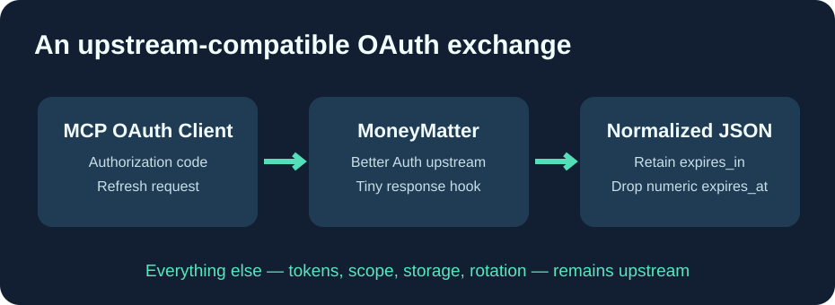

# Cloud9-MoneyMatter

**MoneyMatter upstream, avec un unique correctif OAuth et des builds GHCR automatisés.**

[English](README.md) · Français · [简体中文](README.zh-CN.md)

Ce dépôt public ne maintient **pas une application réécrite** : il suit [MoneyMatter officiel](https://github.com/letehaha/moneymatter) et applique un petit correctif portable. La licence d'origine est **AGPL-3.0**.

## Les apports réels

Le français est **déjà fourni par MoneyMatter upstream** : aucun frontend personnalisé ni patch de traduction n'est nécessaire.

L'unique différence concerne la compatibilité OAuth Better Auth / clients MCP : une réponse réussie d'échange de jeton peut contenir un champ numérique facultatif expires_at, que certains clients Go interprètent comme une chaîne de date RFC3339. Le patch supprime uniquement ce champ pour les réponses réussies de /oauth2/token.

Les vrais jetons, leur durée de validité, leur rotation et leurs droits **ne changent pas**.

## Mises à jour

GitHub Actions récupère la dernière release stable upstream, vérifie la compatibilité du patch, lance les tests OAuth et le typechecking puis construit le backend avec le Dockerfile officiel. Une **image candidate immuable GHCR** est publiée uniquement après succès.

Le frontend recommandé est **letehaha/budget-tracker-fe:latest**, inchangé. Aucun déploiement automatique d'un backend sur une base de données existante n'est effectué : les migrations SQL, OAuth MCP et le retour arrière doivent être validés avant promotion.

Aucun compte, jeton, adresse privée, donnée bancaire ou secret n'est publié. Le correctif est sous AGPL-3.0, comme MoneyMatter.
