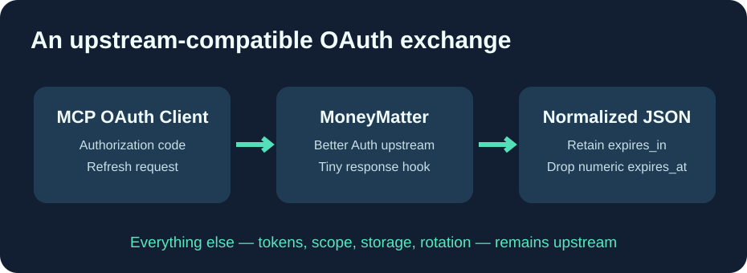

<h1 align="center">Cloud9-MoneyMatter</h1>

<strong>Official MoneyMatter + one small OAuth interoperability fix, automatically rebased and built on GitHub.</strong>

English · <a href="README.fr.md">Français</a> · <a href="README.zh-CN.md">简体中文</a>

This project is **not a rewritten application**. It is a minimal, public patch overlay on the official [MoneyMatter](https://github.com/letehaha/moneymatter), with automatic validation and candidate Docker builds. MoneyMatter is AGPL-3.0; all original copyright and source attribution are preserved.

## What changes versus official MoneyMatter?

The official MoneyMatter frontend and backend **already include French translations**. No French-specific source patch or custom frontend is required.

The only difference is one backend OAuth token-exchange normalization: some Better Auth OAuth Provider responses include an additional numeric expires_at field. OAuth consumers that parse this extension as a timestamp string (notably MCPProxy's Go OAuth client) reject the response even though the authorization code exchange succeeded.

The adapter removes this **optional non-standard numeric field** only from otherwise successful responses at /oauth2/token. It keeps access_token, refresh_token, expires_in, token_type, scope, storage, expiration rules and refresh rotation **unchanged**. It does not edit any banking data.

## Maintenance and releases

1. GitHub Actions resolves the latest official stable MoneyMatter release and clones its exact source.
2. It applies the single three-file patch and fails if the upstream has changed incompatibly.
3. It runs the targeted OAuth unit tests and backend TypeScript typecheck.
4. It builds a backend **candidate image on GitHub** using MoneyMatter's own self-hosting Dockerfile, and publishes a versioned immutable GHCR tag.
5. **Production stays untouched** until OAuth exchange, database migrations, French UI, service health and rollback have been tested. No unverified latest image is promoted automatically.

The **frontend should use the official upstream image** letehaha/budget-tracker-fe:latest. The backend candidate image comes from this repository, while everything except the small patch is still original upstream code.

## Safety, privacy and licensing

This public repository contains only the patch, test evidence, CI, documentation, version metadata, and no database, OAuth client IDs, personal domains, credentials or account data.

**Never blindly replace the production backend with an unverified build**: schema migrations and existing OAuth sessions must be preserved. Test a copy of your database and a live MCP client OAuth flow before deployment.

The original MoneyMatter application is licensed under **GNU Affero General Public License v3**. The distributed derived backend source and this patch follow AGPL-3.0; the complete source can be reconstructed by applying the patch to the upstream release specified by the container labels and CI logs.

Original application: https://github.com/letehaha/moneymatter
