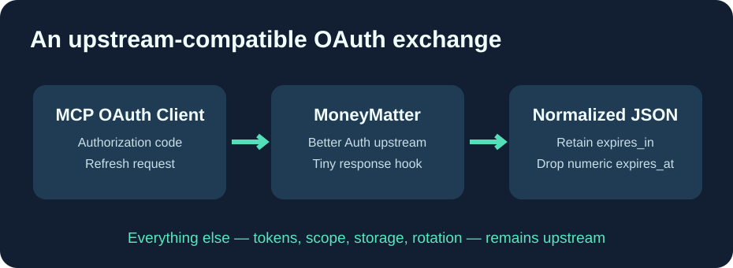

# Cloud9-MoneyMatter

**保留官方 MoneyMatter 源代码，只添加一个 OAuth 兼容性补丁，并由 GitHub 自动构建 GHCR 镜像。**

[English](README.md) · [Français](README.fr.md) · 简体中文

本项目不是重写版应用，而是对 [MoneyMatter 上游项目](https://github.com/letehaha/moneymatter) 的最小补丁集合。继承上游的 **AGPL-3.0** 许可证。

## Cloud9 相比上游的区别

**MoneyMatter 官方版本已经提供法语翻译**，不需要自行维护翻译补丁或特制前端镜像。

唯一的更改是 OAuth 响应兼容性：Better Auth 的令牌交换响应可能额外包含数值类型的 expires_at 字段，一些 Go MCP OAuth 客户端会将其错误地解析为 RFC3339 时间字符串，导致成功的授权被拒绝。

补丁仅在 /oauth2/token 成功响应中移除这个可选字段；访问令牌、刷新令牌、expires_in、权限和令牌轮换逻辑均保持原样。不会修改银行数据。

## 自动维护

GitHub Actions 取得上游最新稳定版，应用补丁，运行 OAuth 单元测试及 TypeScript 类型检查，并使用官方 Dockerfile 构建**不可变候选 GHCR 镜像**。只有测试通过才发布候选版本。

前端继续使用官方镜像 **letehaha/budget-tracker-fe:latest**。在数据库迁移、OAuth 会话和回滚方案实际验证前，绝不自动将候选后端部署到生产环境。

公开仓库不包含用户账户、个人域名、银行数据或 OAuth 密钥。完整源代码由指定上游版本和补丁重建，遵循 AGPL-3.0。
